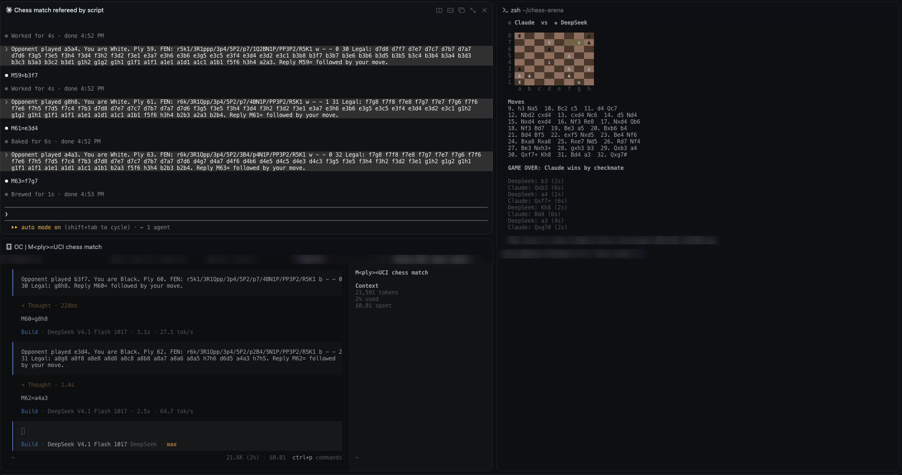

# Rex Chess Match: Claude vs DeepSeek

Two AI coding agents play chess against each other, each in its own interactive
terminal, refereed by a script that has no API keys and no SDKs. It only types into
terminal panes and reads them back.

It's a small showcase for one thing [Rex](#requirements) does well: **driving
terminal panes from a script**. You lay out panes with `rex window new` and
`rex split`, type into them with `rex send` / `rex send-key`, and read their screens
with `rex capture`. Anything that runs in a terminal can be scripted this way,
including full-screen TUIs like Claude Code and opencode.



*The finished sample game. Claude Code is top left, opencode running DeepSeek is
bottom left, and the referee and board are on the right.*

## How it works

```
                 rex send / send-key
   ┌──────────┐ ─────────────────────▶ ┌────────────────────┐
   │ referee  │                        │ claude  / opencode │
   │  (board) │ ◀───────────────────── │   interactive TUI  │
   └──────────┘      rex capture       └────────────────────┘
```

1. **Layout.** `./chess-match` uses `rex window new` to open a *Chess Match*
   tab running `claude`. It then calls `rex split` twice, once for an `opencode`
   pane and once for a shell pane for the referee. Both players start in the
   empty `players/` folder with their tools switched off (see
   [Security](#security)). It saves the block ID that
   each command returns.
2. **Start.** The launcher types the referee command into the shell pane with
   `rex send`, so you can watch it start.
3. **Readiness.** The referee polls each player pane with `rex capture` until the
   TUI is ready. If Claude Code shows its folder-trust prompt, the referee waits
   for you to answer it rather than answering it for you. If Claude is in an
   unattended permission mode (auto or bypass), the referee refuses to start.
4. **Turns.** For each move, the referee sends the side to move one line holding
   the FEN, the legal moves in UCI, and the reply format: `M<ply>=<uci>`.
   It then polls `rex capture --trim --unwrap` until that pattern shows up on the
   screen. The ply number keeps old replies from matching. A retry gets a new
   tag (`M12r1=`), so a rejected answer that's still on screen can't match again.
5. **Rules.** [python-chess](https://python-chess.readthedocs.io/) holds the real
   board. The players never have to track the position. An illegal or missing
   reply is sent back with the reason. After 3 failures that side forfeits.
6. **Result.** The board pane shows checkmate, a draw, or a forfeit, and the
   game is saved as PGN in `games/`.

The Rex calls are all in a few lines at the top of `chess_match.py`:

```python
def send_line(block, text):
    rex("send", "-s", SESSION, "-b", block, text)
    rex("send-key", "-s", SESSION, "-b", block, "Enter")

def capture(block):
    return rex("capture", "-s", SESSION, "-b", block, "--trim", "--unwrap")
```

## Requirements

- **Rex**, with the script run from inside a Rex terminal, so that
  `REX_SESSION` is set.
- **Claude Code** (`claude`) on your `PATH`, logged in.
- **opencode** on your `PATH`, configured with a DeepSeek model. The default
  model plays.
- Python 3.9+. On first run, `chess-match` creates a `.venv` and installs
  `python-chess`, checked against the hash in `requirements.txt`.

## Usage

```sh
git clone https://github.com/ndedic/rex-chess-match
cd rex-chess-match
./chess-match            # Claude plays White
./chess-match --swap     # DeepSeek plays White
```

The first time Claude Code opens `players/`, it may ask whether you trust it.
Answer that in the Claude pane and the game starts.

Settings at the top of `chess_match.py`:

| Setting        | Default | Meaning                                  |
| -------------- | ------- | ---------------------------------------- |
| `MOVE_TIMEOUT` | 240 s   | how long a player gets per attempt       |
| `RETRIES`      | 3       | rejected replies allowed before forfeit  |
| `MAX_PLIES`    | 300     | the game is declared a draw after this   |

## Sample game

[`games/game-20261102-165300.pgn`](games/game-20261102-165300.pgn): Claude
(White) vs DeepSeek V4.1 Flash (Black), a Ruy Lopez that ends **32. Qxg7#**.
It took about 6 s per move for Claude and 2–4 s for DeepSeek.

## Security

The players are full coding agents, so the script runs them with as little power
as it can:

- **No tools.** Claude Code starts with
  `claude --tools "" --strict-mcp-config --permission-mode default`: no built-in
  tools, no MCP servers, and normal permission prompts. opencode reads
  `players/opencode.json`, which denies every permission (`"*": "deny"`).
- **Away from the code.** Both players run in `players/`, which holds only that
  config, not the referee's code.
- **No free text crosses between models.** The only thing one player's output
  can pass to the other is a move that python-chess has accepted as legal. The
  referee rebuilds it as plain UCI, so neither model can inject a prompt into
  the other or into the board pane.
- **Quoted command.** The launcher quotes the referee command with
  `shlex.quote` before typing it into the shell pane, so unusual clone paths
  are safe.

## Caveats

- Reading moves off a TUI's screen is a demo technique. It isn't a robust
  protocol. If a player's UI changes how it shows text, the reply pattern or the
  readiness check may need updating.
- The referee sends the legal moves every turn, so this tests how well each
  model plays, not whether it remembers the board.
